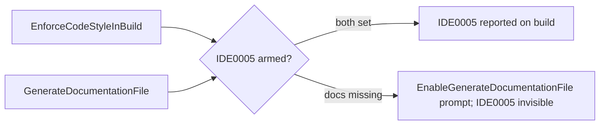

# Build-Time Code-Style Enforcement PRD

**Status:** Planning
**Priority:** Medium
**Last Updated:** 2026-10-20
**Feature ID:** 029
**Scope:** Make the .NET server build enforce the code-style rules `Source/Server/.editorconfig` already declares at `warning` severity, so that violations — most importantly the unnecessary-`using` rule (`IDE0005`) — are reported by `dotnet build` instead of only to an IDE or a separate `dotnet format` run. The mechanism is two MSBuild properties in `Source/Server/Directory.Build.props`, which governs all thirteen projects in `pot.sln`: `EnforceCodeStyleInBuild` and `GenerateDocumentationFile`. No production code changes. The document also records what the second property drags in (the `CS1591` missing-documentation warning), the scoping alternatives, and the decisions the change needs from the developer. It also records the nullable severity policy already carried by the same file, which is a separate mechanism: it changes what happens when the compiler reports a nullable defect rather than making any code-style rule run.

## 1. Purpose

Make an unnecessary `using` directive a build-time warning on the server, so the compiler finds it instead of a later symbol search.

The broader intent is the same for every rule: `.editorconfig` is the declared source of truth for code style in `Source/Server`, but the build ignores most of it. This change makes the build enforce what the configuration already says.

## 2. Problem

### 2.1 The build does not enforce the rules `.editorconfig` declares

`Source/Server/.editorconfig` (`root = true`) sets the following at `warning` severity:

| Line | Setting                                                                                  | Rule                                           |
| ---- | ---------------------------------------------------------------------------------------- | ---------------------------------------------- |
| 210  | `dotnet_diagnostic.IDE0005.severity = warning`                                           | Unnecessary `using` directive                  |
| 212  | `dotnet_naming_rule.interface_should_be_begins_with_i.severity`                          | Interfaces begin with `I`                      |
| 216  | `dotnet_naming_rule.types_should_be_pascal_case.severity`                                | Types are PascalCase                           |
| 220  | `dotnet_naming_rule.non_field_members_should_be_pascal_case.severity`                    | Properties, events and methods are PascalCase  |
| 224  | `dotnet_naming_rule.private_or_internal_const_field_should_be_pascal_case.severity`      | Private/internal `const` fields are PascalCase |
| 228  | `dotnet_naming_rule.private_or_internal_static_field_should_be_pascal_case.severity`     | Private/internal static fields are PascalCase  |
| 232  | `dotnet_naming_rule.private_or_internal_field_should_be_snake_lower_camel_case.severity` | Private/internal fields are `_camelCase`       |

None of it reaches a normal build. `EnforceCodeStyleInBuild` is set in **no** `*.props` or `*.csproj` under `Source/Server` — the only MSBuild properties file under that tree is `Directory.Build.props`, and the solution contains thirteen projects — so the code-style analyzers do not run during a build. The rules are visible in the IDE, and partly to `dotnet format`, but `dotnet build` and `dotnet test` say nothing.

The repository already records this limitation in its own instructions. `.github/instructions/server.instructions.md` asks the developer to run

```
dotnet format style <Project>/<Project>.csproj --verify-no-changes --severity warn --include <changed files>
```

after editing C# files, and states that "naming rules are enforced at `warning` in `.editorconfig`; the normal build does not report them". Enforcement therefore depends on a developer remembering to run a separate tool on the files they touched.

### 2.2 `IDE0005` needs a second switch to run at all

Even after `EnforceCodeStyleInBuild` is added, the unused-`using` rule stays invisible unless a documentation file is generated as well. Without it the compiler emits one prompt per project instead of the diagnostic:

```
CSC : warning EnableGenerateDocumentationFile: Set MSBuild property
'GenerateDocumentationFile' to 'true' in project file to enable IDE0005
(Remove unnecessary usings/imports) on build
(https://github.com/dotnet/roslyn/issues/41640)
```

Microsoft's documentation for `IDE0005` states that the rule requires XML documentation comments to be enabled for the project, and points at [dotnet/roslyn#41640](https://github.com/dotnet/roslyn/issues/41640). This was reproduced on this solution: building `pot.sln` with `EnforceCodeStyleInBuild=true` alone produced thirteen `EnableGenerateDocumentationFile` warnings — one per project — and **zero** `IDE0005` diagnostics (§3.4).

### 2.3 The trigger

During the cross-tenant authorization work, a review found dead `using Microsoft.EntityFrameworkCore;` directives in at least nine files, left behind as queries moved into the repository layer. Neither `dotnet build` nor `dotnet format style --verify-no-changes --severity warn` surfaced them; they were found by symbol search.

That is the concrete evidence that the current configuration cannot see this class of defect. The specific directives have since been removed by hand, so the current tree contains no `IDE0005` violations at all (§3.4). That is precisely why this change is **preventive**: it makes the next one visible, and it is the only way the rule can be observed without a separate tool run.

### 2.4 Consequence

An unenforced rule erodes. Dead usings are among the cheapest defects to introduce and the cheapest to fix; the only reason they accumulate is that nothing reports them.

## 3. Evidence

### 3.1 What is set today

| Fact                                        | Where                                                                                                                                                                                     |
| ------------------------------------------- | ----------------------------------------------------------------------------------------------------------------------------------------------------------------------------------------- |
| `EnforceCodeStyleInBuild` is set nowhere    | Only `Directory.Build.props` exists under `Source/Server`; no `.csproj` or `.props` sets it                                                                                               |
| `GenerateDocumentationFile` is set nowhere  | No `*.csproj` or `*.props` under `Source/Server`                                                                                                                                          |
| `TreatWarningsAsErrors` is set nowhere      | No `*.csproj` or `*.props` under `Source/Server`; `WarningsAsErrors` promotes only the nullable set (§3.6)                                                                                                                                          |
| `CS1591` is suppressed nowhere              | The only `NoWarn` is `Directory.Build.props:15` → `$(NoWarn);IDE0290;CA1873`                                                                                                              |
| The property group applies to every project | `Directory.Build.props` is unconditional; it already gates coverlet exclusions with `$(MSBuildProjectName.EndsWith('.Tests')) or $(MSBuildProjectName.EndsWith('.TestUtils'))` at line 19 |
| Projects affected                           | 13, per `pot.sln`                                                                                                                                                                         |

### 3.2 Historical note — the `Pot.Data` suppression

`Pot.Data/Pot.Data.csproj` previously carried a blanket `<NoWarn>$(NoWarn);IDE0005</NoWarn>`. That has been replaced with a file-scoped suppression in `Source/Server/.editorconfig` (lines 279–282):

```ini
# EF-generated migrations are produced from a fixed template, so their unused usings are not ours to maintain.
# This section must stay last: an EditorConfig section applies to every setting that follows it.
[/Pot.Data/Migrations/*.cs]
dotnet_diagnostic.IDE0005.severity = none
```

The reason is that hand-cleaning EF-generated files does not survive the next `add-migration`. This part is already in place; this PRD covers the build enforcement that is not.

### 3.3 How the measurements below were taken

All figures were measured on 2026-10-12 with `dotnet` selecting SDK `11.0.100-preview.6.26359.118` (`Source/Server` has no `global.json`; there is no parent `.editorconfig`, since `Source/Server/.editorconfig` sets `root = true`). The projects target `net10.0`. The trial builds passed the two properties on the command line and redirected all build output outside the repository with `--artifacts-path`, so no file under `Source/` was written:

```
dotnet build pot.sln -c Debug -p:EnforceCodeStyleInBuild=true -p:GenerateDocumentationFile=true --artifacts-path <outside-source>
```

### 3.4 Measured results

| Configuration                                           | Warnings | Errors | IDE diagnostics | Notes                                                           |
| ------------------------------------------------------- | -------- | ------ | --------------- | --------------------------------------------------------------- |
| As-is (baseline)                                        | 0        | 0      | 0               | —                                                               |
| `EnforceCodeStyleInBuild` only                          | 13       | 0      | 0               | one `EnableGenerateDocumentationFile` prompt per project        |
| `EnforceCodeStyleInBuild` + `GenerateDocumentationFile` | 2200     | 0      | 0               | every warning is `CS1591`; no `IDE0005`, no naming-rule warning |

Distinct warnings per project in the third row (all `CS1591`):

| Project                          | Warnings |
| -------------------------------- | -------- |
| Pot.App.Tests                    | 586      |
| Pot.App                          | 459      |
| Pot.Data.Tests                   | 290      |
| Pot.AspNetCore                   | 226      |
| Pot.Data                         | 214      |
| Pot.AspNetCore.Integration.Tests | 123      |
| Pot.AspNetCore.Tests             | 104      |
| Pot.RazorComponents              | 64       |
| Pot.Shared                       | 51       |
| Pot.Shared.Tests                 | 40       |
| Pot.EmailSender                  | 26       |
| Pot.TestUtils                    | 15       |
| Pot.Data.Migrations              | 2        |

Split by kind: **1158** warnings come from the six test projects (`*.Tests`, `*.TestUtils`) and **1042** from the seven production projects.

Two conclusions matter:

1. The code-style analyzers **are** active once `EnforceCodeStyleInBuild` is set — the `EnableGenerateDocumentationFile` prompt in row 2 is emitted _because_ the property is on and `IDE0005` is configured at `warning`. So the zero IDE diagnostics in row 3 is a real "no violations today" result, not a failure to run.
2. The entire new warning volume comes from `CS1591`, which is a side effect of the second property, not from the code-style rules this change is about.

### 3.5 Mechanism check (throw-away project, outside the repository)

A minimal `net10.0` project with `.editorconfig` setting `dotnet_diagnostic.IDE0005.severity = warning` and one file containing a dead `using System.Text;`:

| Configuration                                           | Dead `using` reported?                                            |
| ------------------------------------------------------- | ----------------------------------------------------------------- |
| `EnforceCodeStyleInBuild` only                          | No — only the `EnableGenerateDocumentationFile` prompt            |
| `EnforceCodeStyleInBuild` + `GenerateDocumentationFile` | Yes — `IDE0005: Using directive is unnecessary`                   |
| Same, but the file starts with `// <auto-generated />`  | No — `IDE0005` skips generated files; `CS1591` still fires for it |

### 3.6 The nullable severity policy already in the same file

`Source/Server/Directory.Build.props` carries a second, unrelated setting, adopted on 2026-10-20:

```xml
<WarningsAsErrors>$(WarningsAsErrors);nullable</WarningsAsErrors>
```

It is a severity policy, not an enforcement switch. It does not make any analyzer or code-style rule run; it changes what happens when the compiler already reports a nullable defect. `nullable` is the SDK shorthand for the whole nullable diagnostic family rather than a single code, so the next nullable mistake fails the build whichever `CS86xx` number it arrives under.

Measured when it was adopted: a full rebuild of `pot.sln` produced no nullable warning other than `CS8604`, and those eight sites were fixed rather than suppressed, each by asserting the value was present before it was used. A throw-away probe then confirmed the policy bites — a possibly-null argument passed to `ShouldContain` reported `error CS8604` and `Build FAILED` — and the rebuild after removing the probe was clean.

`TreatWarningsAsErrors` was deliberately not used, because the build already carries eight `NU1902`/`NU1903` package-vulnerability warnings and `NETSDK1057`, which that property would turn into build failures on pre-existing debt. The result is that **nullable defects are build failures solution-wide, while every other warning — including the `CS1591` this PRD introduces — stays advisory.**

## 4. Proposed Configuration

Add to `Source/Server/Directory.Build.props`, which governs every project in the solution:

```xml
<PropertyGroup>
    <!-- Surface IDE code-style rules as build warnings. IDE0005 additionally requires documentation file
         generation, per dotnet/roslyn#41640 - without it the rule never runs during a build. -->
    <EnforceCodeStyleInBuild>true</EnforceCodeStyleInBuild>
    <GenerateDocumentationFile>true</GenerateDocumentationFile>
</PropertyGroup>
```

## 5. Why Both Properties Are Required

`EnforceCodeStyleInBuild` makes the code-style analyzers run during a build; on its own it surfaces the naming rules but **not** `IDE0005`. The compiler only computes `IDE0005` when a documentation file is generated, which is why `GenerateDocumentationFile` is part of the change rather than an optional extra. The two properties are therefore a pair: dropping the second silently removes the primary capability this work exists to add — and does so _loudly_, by emitting a `EnableGenerateDocumentationFile` prompt in every project that says exactly what is missing.



Note the asymmetry: `GenerateDocumentationFile` alone does nothing for IDE0005 either. The rule needs the analyzer to run _and_ the documentation pass to happen.

## 6. What To Watch For

### 6.1 Only the rules configured at `warning` surface, and today none of them are violated

`EnforceCodeStyleInBuild` enables the IDE analyzers; which diagnostics become visible depends on severity. The only rules this repository sets to `warning` are `IDE0005` and the six naming rules in §2.1. The many `dotnet_style_*` / `csharp_style_*` preferences in `.editorconfig` carry no explicit severity, so they stay at whatever the analyzer's default is and did not appear in the measurement.

The measured outcome is therefore **not** the anticipated broad wave of style warnings: the trial build produced zero IDE diagnostics across the whole solution. Today's code satisfies `IDE0005` and all six naming rules. This is a property of the current code, not a permanent guarantee — the point of the change is that new code will now be checked, so a slow rise in warnings is the expected, desirable behaviour.

The real cost to a clean build log is §6.2.

### 6.2 `GenerateDocumentationFile` brings `CS1591` with it

`CS1591` (missing XML documentation on a publicly visible member) is suppressed nowhere in the solution today, so turning on documentation-file generation immediately adds **2200** warnings: **1042** in production projects and **1158** in test projects.

Nothing breaks — no warning in this family is fatal, because `TreatWarningsAsErrors` is unset and `WarningsAsErrors` covers only the nullable set (§3.6) — but every build becomes noisy and a clean log is no longer a usable signal.

The tension this creates is worth stating plainly. The server instructions already **require** XML docs on the public and internal API, so `CS1591` on a production project is a legitimate complaint about real debt. The same instructions also say the opposite for tests: "Do not add docs just to silence an analyzer on trivial boilerplate, generated code or test helpers; suppress the warning instead." So the same warning is useful in production projects and unwanted in test projects. That makes `CS1591` a policy choice rather than a technical one; the options are in §7 and §8.

### 6.3 Generated code

The existing `Pot.Data/Migrations/*.cs` override (§3.2) is **load-bearing and should stay**:

- The EF migration _main_ files are not auto-generated, and four of them carry a `using System;` that `ImplicitUsings` (`Directory.Build.props:5`) makes redundant: `20260404001902_MakeAccrualStartDateNullable.cs:1`, `20260501140712_AddAuthSession.cs:1`, `20260503111438_RemoveLegacyRefreshTokenFields.cs:1` and `20260927061628_DropAccountAccrualAndAggregates.cs:1`. Without the override these would produce `IDE0005` on every build, and hand-editing them would not survive the next `add-migration`.
- The `*.Designer.cs` files and `PotDbContextModelSnapshot.cs` are marked `// <auto-generated />` and would be skipped by `IDE0005` anyway (§3.5), but keeping the explicit override is the safer statement of intent.
- These files produce no `CS1591` either: the migration classes carry `/// <inheritdoc />`, and the snapshot type is internal. Measured: the `Pot.Data.Migrations` project contributes only two `CS1591` warnings, both from its hand-written `PotDbContextFactory.cs`.

No other generated code needs excluding today. There are no `*.g.cs` files under `Source/Server`, no other `// <auto-generated />` files besides the EF migration artifacts above, and Razor-generated code is produced under `obj/`. If another generator is introduced later, the `.editorconfig` section is the mechanism to extend — remembering that, as its own comment notes, an EditorConfig section applies to every setting that follows it, so it must stay last.

### 6.4 Every project in the solution, including the test projects

`Directory.Build.props` is unconditional, so the properties reach all thirteen projects, test projects included. This is confirmed by the measurement — `Pot.TestUtils`, the five `*.Tests` projects and the production projects all report the new warnings. Scoping the properties away from tests requires an explicit condition (the file already demonstrates the pattern at line 19); it does not happen by accident.

### 6.5 CI and other build entry points

There is no pipeline definition in this repository: no `.github/workflows`, no `azure-pipelines*`, and the only YAML files are the Docker Compose files. Nothing passes `-warnaserror`. The build entry points that exist are local (`dotnet build`, `dotnet test`), `Source/Server/code_coverage.ps1` (which runs `dotnet test pot.sln`), and the server image build (`Source/Docker/Server/Dockerfile`, which publishes only `Pot.AspNetCore` and `Pot.Data.Migrations`). All of them inherit the properties, so all of them already fail on a nullable defect through the separate policy in §3.6, and none of them fails on the `CS1591` warnings this change introduces. If an external pipeline builds this repository, whether it treats new warnings as failures must be confirmed before landing — that cannot be verified from the repository itself.

## 7. Scoping Options

| Option | What changes                                                           | Immediate new warnings | `IDE0005` visible solution-wide? | Comment                                                                               |
| ------ | ---------------------------------------------------------------------- | ---------------------- | -------------------------------- | ------------------------------------------------------------------------------------- |
| A      | Solution-wide, both properties, no suppression                         | 2200                   | Yes                              | The straightforward version of the change                                             |
| B      | Solution-wide, both properties, `CS1591` in `NoWarn` for test projects | 1042                   | Yes                              | Recommended first step (see §8) — removes the test noise, keeps the production signal |
| C      | Solution-wide, both properties, `CS1591` in `NoWarn` everywhere        | 0                      | Yes                              | Cleanest log; discards the documentation signal for production projects               |
| D      | Per project (for example `Pot.Data.csproj` only)                       | ~214                   | No — other projects stay blind   | Useful as a pilot to size the debt, not as the end state                              |
| E      | `EnforceCodeStyleInBuild` only                                         | 13 prompts             | **No**                           | Not viable: the rule this work is about stays invisible (§5)                          |

## 8. Decision Points

| ID   | Decision                        | Options                                                                                | Recommendation and reasoning                                                                                                                                                                                                       |
| ---- | ------------------------------- | -------------------------------------------------------------------------------------- | ---------------------------------------------------------------------------------------------------------------------------------------------------------------------------------------------------------------------------------- |
| DP-1 | Scope of the change             | Solution-wide in `Directory.Build.props` / per project / single-project pilot          | **Solution-wide (A/B/C).** Per-project scoping leaves every unconverted project blind, which is the defect class this exists to close and which per-project scoping would re-open with each new project.                           |
| DP-2 | `CS1591` in test projects       | Leave on (2200 warnings) / suppress for `*.Tests` and `*.TestUtils` (1042)             | **Suppress.** The server instructions explicitly say not to document test helpers and to suppress instead, so the warnings would be noise by the repository's own policy. Also removes half the new volume at no cost.             |
| DP-3 | `CS1591` in production projects | Leave on (1042 warnings) / suppress until the docs are written                         | **Leave on.** It is consistent with the existing requirement to document the public API, and suppressing it would hide real debt. If a clean build log is a hard requirement now, use option C temporarily and track the doc work. |
| DP-4 | Migrations                      | Keep the `IDE0005` override as-is / also suppress `CS1591` there / remove the override | **Keep as-is.** It is required for `IDE0005` (§6.3), and migrations already produce no `CS1591`.                                                                                                                                   |
| DP-5 | Are warnings fatal?             | Advisory (as today) / `TreatWarningsAsErrors` later / nullable as errors                                    | **Advisory for every warning this PRD introduces; the nullable family is already a build error (§3.6).** `TreatWarningsAsErrors` stays rejected: `CS1591` is a documentation warning, not a nullable defect, and the pre-existing vulnerability warnings must not gate the build.                                                                                               |
| DP-6 | External pipelines              | None in this repository / confirm an external one                                      | **Confirm before landing** whether any external build fails on new warnings (§6.5).                                                                                                                                                |

**Recommended first step (option B).** Land both properties solution-wide in `Directory.Build.props` — they must travel together — and add `CS1591` to `NoWarn` for the test projects only, reusing the `$(MSBuildProjectName.EndsWith('.Tests')) or $(MSBuildProjectName.EndsWith('.TestUtils'))` condition already in that file. This delivers the whole point of the change (`IDE0005` and the naming rules enforced on every build, in every project) while keeping the immediate new warning volume to the 1042 legitimate production `CS1591` warnings, which can then be paid down deliberately. Enabling only the first property is not a usable increment: it adds thirteen prompts and still cannot see `IDE0005`.

## 9. Scope

- Add `EnforceCodeStyleInBuild` and `GenerateDocumentationFile` to `Source/Server/Directory.Build.props`, scoped as decided in §8.
- Apply the agreed `CS1591` policy for the warning the second property introduces.
- Confirm the existing `Pot.Data/Migrations` override still suppresses `IDE0005` for generated migrations.
- Confirm the solution still builds and tests green, with warnings advisory apart from the nullable family (§3.6).

## 10. Out of Scope

- **No production code changes.** No usings are removed, no documentation is written, no naming is changed. The change is build configuration only.
- **No change to the rules themselves.** `.editorconfig` severities stay as they are; this change only makes the existing configuration reach the build.
- **No `TreatWarningsAsErrors`.** The `CS1591` this change introduces, and every other warning it can surface, stays advisory. The nullable family is already a build error through the separate policy in §3.6; this change neither widens nor narrows it.
- **No new analyzer packages or analysis-level changes.**
- **No client-side build changes.** The React client's lint and type-check are separate.
- **No CI/pipeline authoring.** DP-6 only confirms existing behaviour.

## 11. Acceptance Criteria

- `Source/Server/Directory.Build.props` sets `EnforceCodeStyleInBuild` and `GenerateDocumentationFile` (per the agreed scope), and `CS1591` is handled per the agreed policy.
- `dotnet build pot.sln -c Debug` from `Source/Server` completes with zero errors.
- Introducing a redundant `using` in a hand-written, non-generated `.cs` file in a covered project produces `warning IDE0005` naming that file and line; removing it clears the warning.
- The same experiment in `Pot.Data/Migrations/*.cs` stays silent: the file-scoped override holds.
- `IDE0005` stays silent in `// <auto-generated />` files.
- `dotnet test pot.sln` still passes.
- The measured warning set after the change matches the agreed target: zero IDE diagnostics from today's code, plus the agreed `CS1591` policy.
- No `TreatWarningsAsErrors` is introduced, and the nullable policy in §3.6 survives: a deliberate nullable defect still fails the build.

## 12. Validation

Because the properties are what arm the rule, **a clean build proves nothing on its own** — the baseline is already silent (§3.4). The change has to be demonstrated by a deliberate violation, and the generated-code policy by an existing one.

1. **Baseline** (no repository change): `dotnet build pot.sln -c Debug` from `Source/Server` reports 0 warnings, 0 errors.
2. **Trial** (no repository change, output redirected outside the repository):
   `dotnet build pot.sln -c Debug -p:EnforceCodeStyleInBuild=true -p:GenerateDocumentationFile=true --artifacts-path <outside-source>`.
   Record the warning counts and confirm they match §3.4 before landing anything.
3. **With the change in place**, add an unused `using` to a hand-written file in a covered project (for example a small usings-only addition to a `Pot.App` feature). Rebuild and confirm `IDE0005` is reported for that file and line. Remove the line and confirm the warning clears. This is the observation that the baseline cannot make.
4. **Generated migrations stay silent**: confirm no `IDE0005` is reported for `Pot.Data/Migrations/**`, which today contains four files with a redundant `using System;` (listed in §6.3). No edit is needed — their silence is the assertion.
5. **Generated files stay silent**: confirm no `IDE0005` for `*.Designer.cs` or `PotDbContextModelSnapshot.cs`.
6. **Whole-solution health**: `dotnet build pot.sln -c Debug` (0 errors) and `dotnet test pot.sln -c Debug --nologo --verbosity minimal` both green, with warnings still advisory.
7. **Nullable severity unchanged**: repeat the probe from §3.6 — a possibly-null argument passed where a non-nullable one is required — and confirm the build fails with `error CS8604` naming the file and line; remove it and confirm a clean rebuild.

## 13. Assumptions

| ID   | Assumption                                                                                                                     | Status                                                                                                            |
| ---- | ------------------------------------------------------------------------------------------------------------------------------ | ----------------------------------------------------------------------------------------------------------------- |
| A-01 | No pipeline outside this repository treats new build warnings as failures.                                                     | Not verifiable from the repository; confirm before landing (DP-6)                                                 |
| A-02 | The SDK in use supports `EnforceCodeStyleInBuild` and the `IDE0005` documentation-file requirement.                            | Verified by measurement (§3.4, §3.5)                                                                              |
| A-03 | EF continues to generate migrations from the same template, so the `Pot.Data/Migrations` `IDE0005` override remains necessary. | Stated as policy; it is a documented, hand-maintained override                                                    |
| A-04 | The nine dead usings described in §2.3 existed as reported.                                                                    | Received from the review; the directives are no longer present, so the finding is recorded rather than reproduced |

## 14. Related Documents

- [PRD-026 — Cross-Tenant Authorization Hardening](PRD-026-cross-tenant-authorization-hardening.md): the work during which the dead `using` directives were found, and whose repository-layer changes removed them.
- [PRD-020 — Server Test Runner Migration](PRD-020-test-runner-mtp-migration.md): the other track that changes how the server solution is built and tested.
