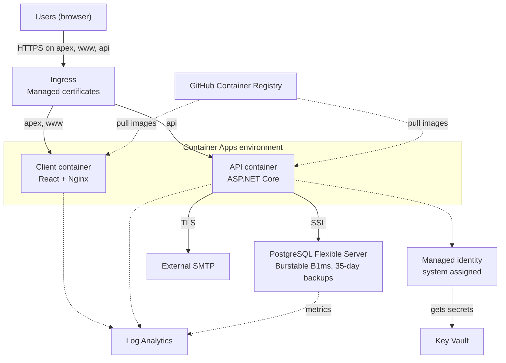

# ADR-0062: Production runs on managed Azure services in Australia East

**Summary:** In the context of a personal finance tracker operated by one developer for a handful of
people, facing hosting that nobody is paid to maintain and a bill that has to stay in the low tens of
dollars, we decided to run production as two container apps in one Azure Container Apps environment with
a single Burstable PostgreSQL Flexible Server, all in Australia East, to achieve an estate that needs no
patching, accepting cold starts, deployment gaps, a bill that follows traffic and no copy of the data
outside the database server.

## Context and Problem Statement

The application is a stateless API, a static client and a relational database. It is deployed, not
operated: there is one developer, no on-call rota and no budget line. Traffic is a few hundred requests
a day from one or two people, so almost any fixed-capacity arrangement pays for idle time. That budget
constrains the answer more than the load does, because the estate has to be cheap enough to leave
running.

Several records already describe the application's shape — two container apps
([ADR-0032](ADR-0032-production-runs-two-container-apps.md)), TLS at the ingress
([ADR-0033](ADR-0033-public-tls-terminates-at-the-container-apps-ingress.md)), deployments run by hand
([ADR-0031](ADR-0031-builds-and-deployments-are-run-by-hand.md)), separate releases with accepted skew
([ADR-0060](ADR-0060-the-client-and-server-deploy-separately-and-api-version-skew-is-accepted-for-minutes.md)).
None of them records which platform all of that runs on, or why.

The platform was chosen while preparing the first deployment, on 2025-11-02. Those notes survive only as
a private runbook — `Docs/Azure/Azure-Deployment-Notes.md`, git-ignored and never to be committed — so
this record is the durable statement of the reasoning.

## Decision Drivers

- One developer, no on-call: a monthly patching or upgrade chore is a cost that is never repaid.
- Idle capacity is wasted money, so paying per request matters more than paying less per unit.
- The users are in Australia, and the data is personal financial data, so it should stay in Australia.
- The bill must stay in the low tens of dollars a month, and cheaper is better at equal effort.
- The local development stack is Docker Compose, so the amount of change to deploy should be small.

## Considered Options

1. Managed platform services: two Container Apps in one environment, one Burstable PostgreSQL Flexible
   Server, images from GitHub Container Registry, Key Vault behind a managed identity, all in Australia
   East, database automated backups as the only backup.
2. A single Linux virtual machine running the existing Docker Compose stack.
3. The same managed services with the Azure-native extras: Azure Container Registry instead of GitHub's,
   Blob storage for backups, and the database in Southeast Asia.

## Decision Outcome

Chosen option: 1. Production is one Azure Container Apps environment holding the client and the API, a
single PostgreSQL Flexible Server on the Burstable B1ms tier with 35-day backup retention, and a
system-assigned managed identity reading secrets from Key Vault. Images are stored in GitHub Container
Registry and pulled with a personal access token. Everything sits in Australia East, and every service is
priced per use.

Option 2 was rejected on the first driver: a virtual machine at this size costs less per month but needs
operating-system patching, Docker upgrades and its own backup routine, which is the work the estate
exists to avoid. Option 3 was weighed service by service and rejected in each case: the registry for
about $7 a month, the backups for about $1-2 a month, and the region because the difference turned out
to be about $3-5 a month against noticeably worse latency for the users. The three together were not
worth roughly $12 a month on a bill of about $15.

### Consequences

- Good, because nothing in the estate needs patching: the platform upgrades the hosts, and the database
  takes minor version upgrades on its own.
- Good, because there is no fixed capacity to pay for, so the whole estate comes to roughly $13-18 AUD a
  month, almost all of it the database.
- Good, because the application data stays in Australia, which is where the people in it live.
- Bad, because consumption pricing means the client can scale to zero, so the first request after a quiet
  period waits for a cold start. The API is pinned to a minimum of one replica, which removes its cold
  start at the cost of a permanently warm instance; the client is left to go cold.
- Bad, because the database is the only copy. Automatic backups give point-in-time recovery to 35 days
  inside the same service, but nothing protects against losing the subscription or the region.
- Bad, because the monthly cost follows traffic rather than being a fixed number, so the first sign of a
  change in usage is the invoice.
- Bad, because none of the estate is described as code: the environment, the tiers, the scale rules and
  the Key Vault references are set in the portal and recorded only by this document and a private
  runbook. What runs can differ from what is written here, and nothing detects the difference.

### Confirmation

- Review: a change to any of the rules below is a change to this record, not a tuning tweak.
  - A new production Azure resource, or a tier, region or registry change to an existing one, updates this
    record first.
  - Any backup beyond PostgreSQL's automatic ones departs from the decision, which rejected them on cost.
  - Images do not move to Azure Container Registry without revisiting the registry comparison.
- Review: the diagram is rendered from `Docs/reference/diagrams/pot_azure_diagram.mmd` and embedded here,
  so the two change together.
- Gap: nothing checks the deployed estate against this record — no infrastructure definition, no drift
  detection, no test — so comparing the portal with this page is a manual act.

## More Information

### The deployed shape

### What the estate costs each month

| Service | Configuration | Cost |
| --- | --- | --- |
| PostgreSQL Flexible Server | Burstable B1ms, Australia East, 35-day retention | ~$13-16 AUD |
| Container Apps | Consumption, two apps, minimum of one API replica | ~$0-2 AUD |
| Key Vault | Standard, inside the free operation allowance | free |
| Log Analytics and Application Insights | Inside the free ingestion allowance | free |
| GitHub Container Registry | Private packages on a personal plan | free |

### Related

- Two container apps rather than one proxy: [ADR-0032](ADR-0032-production-runs-two-container-apps.md),
  whose "Known scale-out risks" apply whenever more than one API replica runs.
- Where TLS terminates: [ADR-0033](ADR-0033-public-tls-terminates-at-the-container-apps-ingress.md).
- How a release reaches the estate: [ADR-0031](ADR-0031-builds-and-deployments-are-run-by-hand.md).
- The database and its minor-version behaviour:
  [ADR-0005](ADR-0005-postgresql-is-the-relational-datastore.md).
- CORS and the cross-origin boundary the two apps create:
  [ADR-0020](ADR-0020-cross-origin-access-is-limited-to-configured-browser-origins.md).
- The diagram sources are `Docs/reference/diagrams/pot_azure_diagram.mmd` and its rendered
  `pot_azure_diagram.png`.
